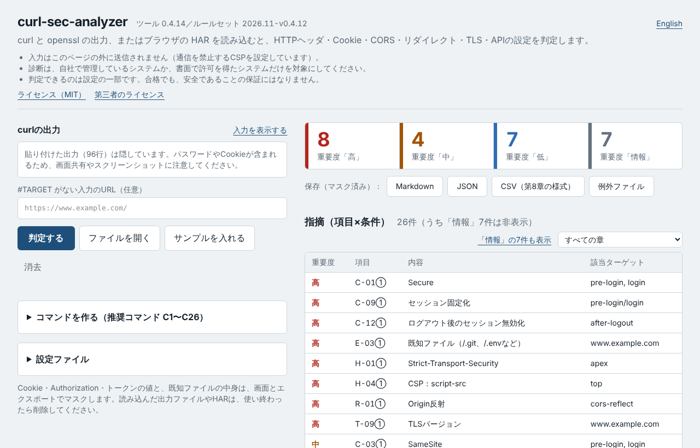

# curl-sec-analyzer

curl と openssl の出力、またはブラウザの HAR を読み込むと、Webアプリ・WebAPIのセキュリティ設定（HTTPヘッダ、Cookie、CORS、リダイレクトなど）を判定する静的サイトです。



- **対象に一切アクセスしません。** 診断者が自分で curl を実行し、その出力を貼り付けます。
- **入力はブラウザの外に送信されません。** メタCSPの `connect-src 'none'` で通信を禁止しています。
- **秘密情報はマスクして表示します。** Cookie、Authorization、名前の付いたトークンの値は伏せて表示します（残りうるものは CHANGELOG の「既知の限界」）。

> 診断は、自社で管理しているシステムか、書面で許可を得たシステムだけを対象にしてください。
>
> curl の出力・HAR・`login.txt`・Cookie の jar にはパスワードやトークンがそのまま入っています。Issue やチャットに貼らないでください（[SECURITY.md](SECURITY.md)）。リポジトリの中で採取する場合も、これらのファイルは `.gitignore` で除外しています。

## 使い方

1. 画面の「コマンドを作る」でスクリプトを作って実行し、`out.txt` を作ります（簡易版の `run.sh` もあります）。
2. ツールを開き、`out.txt` を貼り付けるか「ファイルを開く」で読み込んで「判定する」を押します。HAR は「ファイルを開く」で読み込み、ラベルを確認してから判定します。
3. 使い終わったら `out.txt`、`login.txt`、`jar.txt`、`old.txt`、`s1.txt`〜`s3.txt`、HAR ファイルを削除します。

1つの貼り付けに複数の応答を入れるときは、各応答の前に次の行を置きます。

```
#TARGET url=https://www.example.com/mypage label=mypage sensitive=1
```

## 現在の状態：1.0.0

自動で判定できる項目（手動確認の8項目を除く70項目）をすべて実装しています（T-07①③・C-04②・H-11③の条件は手動確認）。版ごとの変更と既知の限界は [CHANGELOG.md](CHANGELOG.md) にあります。主な機能は次のとおりです。

- **前回との差分**：「設定ファイル」→「前回の結果（JSON）を読み込む」で、以前にエクスポートしたJSONと比べ、新規・解消・重要度の変化・例外登録・再診断していない・継続に分けて表示します。curl のターゲットはラベルで、HAR のターゲットはメソッドとURLで突き合わせます（HAR のラベル番号は記録し直すと変わるため）。前回と組織プロファイルかルールセットの版が違う場合は警告します。Markdown にも差分の表が入ります。
- **組織プロファイル**：`profile.json` で、項目・条件ごとの重要度、判定しない項目、セッションCookieの名前（推定を上書き）、C-05 の期限の基準、E-08 で自社の配信元とするスクリプトの配信元（`trustedScriptOrigins`）を組織ごとに決められます。ひな形は画面の「プロファイルのひな形」から保存できます。プロファイルで変えた重要度は、ターゲットごとの表とホスト単位・ターゲット横断の表で「*」と元の重要度を、Markdown で「*」と凡例を示し、対象外の項目は診断カバレッジで「対象外」になります。

```json
{
  "name": "組織名・プロファイル名",
  "severity": { "H-10": "low", "H-14.1": "info" },
  "exclude": ["T-12"],
  "sessionCookieNames": ["APPSESSION"],
  "sessionMaxAgeHours": 12,
  "trustedScriptOrigins": ["https://assets.example.com"]
}
```

- **英語UI**：右上の「English」で切り替えます（ブラウザの言語が日本語以外なら英語で始まります。`?lang=en` でも指定できます）。画面の文言、項目名、重要度、推奨対応、Markdown が英語になります。判定の証跡、解析の警告、CSV（第8章の記録様式）、生成したスクリプトは日本語のままです。

CSP（H-04・H-05・H-07）は Google の csp_evaluator（Apache-2.0）で評価し、指摘をチェックリストの条件に振り分けています。

そのほかの機能：curl・openssl・HAR の取り込み、コマンド生成器、ラベル対応表、ターゲット横断・ホスト単位の判定、診断カバレッジ、例外登録、Markdown・JSON・CSV のエクスポート（マスク済み）。

v1.0 の範囲として、各項目を **OWASP ASVS 5.0.0** の要件と **IPA「安全なウェブサイトの作り方」改訂第7版** の項番に対応付けました。画面の項目名の横、Markdown（診断カバレッジの表の「ASVS 5.0.0」「IPA」列）、JSON（`standards`）に出ます。これは関連する要件の番号で、その要件を満たすかどうかの判定ではありません（対応の持ち方は設計書の「ASVS 5.0・IPAとの対応」）。

ブラウザだけで使う運用のため、CLI 版は作りません（`docs/design.md` の「判断の根拠」14）。版は 1.0.0 からセマンティックバージョニングで付けます（`docs/design.md` の「版の付け方」）。

## 開発

Node.js は `.nvmrc` の版（24）を使います（22.12 以降なら動きます）。開発の決まり（コミットの書き方、テスト用の入力の扱い、AI エージェントに許す操作など）は [CONTRIBUTING.md](CONTRIBUTING.md) にあります。

```sh
npm ci
npm run dev          # 開発サーバ（メタCSPは本番ビルドだけに入る）
npm test             # 単体テスト（Vitest。時間を測るテストは最後に別に流す。変更を監視するときは npm run test:watch）
npm run lint         # 型チェック（tsc）と ESLint（innerHTML・eval の禁止を含む）
npm run audit        # 依存の署名の検証と、公開物に含まれる依存の既知の脆弱性（high 以上）の検査（CI と同じ）
npm run build        # 型チェック＋本番ビルド（dist/）
npx playwright install chromium firefox webkit
npm run test:e2e     # E2E（先に npm run build が必要。本番ビルドに対して実行。Chromium・Firefox・WebKit。外部へのリクエストがないこと、アクセシビリティも確認）
npm run screenshot   # README の画像（docs/screenshot.png）と共有用の画像（public/og.png）を撮り直す。リリースのたびに実行する
```

| ディレクトリ | 内容 |
|---|---|
| `src/parser/` | 貼り付けの解析（#TARGET、-i、-D -、-v、-L、openssl）、HAR の取り込み、Set-Cookie の解析 |
| `src/rules/` | 判定ルール（第1〜6章） |
| `src/ui/` | 画面の部品（結果、HAR、コマンド生成器、例外のダイアログ、状態） |
| `src/engine/` | 入力から判定までの流れ、ルールの実行、ラベル対応表、例外、組織プロファイル、前回との差分と突き合わせのキー、診断カバレッジと項目の台帳、規格の対応、集計 |
| `src/export/` | Markdown・JSON・CSV のエクスポート |
| `src/`（直下） | コマンド生成器（`commands.ts`）、マスク（`mask.ts`・`shownText.ts`・`tokenShape.ts`）、画面の文言と英訳（`i18n.ts` など）、画面の入口（`main.ts`）、判定と HAR の読み込みの Web Worker（`analyzeWorker.ts`・`harWorker.ts`）、型と版（`model.ts`・`version.ts`） |
| `tests/` | 単体テストと fixture。領域ごとのテストは直下、レビューの回ごとの回帰テストは `tests/regression/` |
| `e2e/` | Playwright の E2E と、axe-core によるアクセシビリティの検査 |
| `docs/design.md` | チェックリストと設計書（正本） |
| `docs/history.md` | 設計書のレビューの経緯 |

## 公開

専用の組織アカウントのリポジトリで管理し、`https://<組織名>.github.io/curl-sec-analyzer/` で公開します。個人アカウントの他の GitHub Pages とはオリジンが分かれます。

- プルリクエストごとに、GitHub Actions（`ci.yml`）が依存の検査・型チェック・テスト・ビルド・E2E を実行します。`main` への push では同じ検査（`deploy.yml`）に通ったビルドだけを GitHub Pages に公開します。リポジトリの Settings → Pages で Source を「GitHub Actions」にしてください。
- 公開リポジトリでは、CodeQL（コードとワークフローの脆弱性）と dependency-review（プルリクエストで新しく入る依存）も実行します。dependency-review のために、Settings → Code security で Dependency graph を有効にしてください。
- `vite.config.ts` は `base: './'` なので、サブパス（`/curl-sec-analyzer/`）でも独自ドメインでも動きます。独自ドメインで公開する場合は、共有用の画像のURLのために、リポジトリの変数 `SITE_URL`（Settings → Secrets and variables → Actions → Variables）に公開URLを設定してください。
- 同じ組織の他の Pages とはオリジンを共有します。ツールはブラウザに何も保存せず、他のページへの埋め込みも拒否しますが、同じ組織の Pages に信頼できないコードや外部のスクリプトを読み込むページを置かないでください（理由は `docs/design.md` の「公開先とオリジン」）。

## ライセンス

MIT License（`LICENSE`）。公開したページの「第三者のライセンス」から、ビルドに含まれる依存パッケージのライセンスを確認できます（ビルド時に `THIRD_PARTY_LICENSES.txt` を生成します）。

## 脆弱性の報告

このツール自体の脆弱性は、公開の Issue ではなく GitHub の「Report a vulnerability」から報告してください（[SECURITY.md](SECURITY.md)）。誤検知・見落としの報告は Issue テンプレートを使い、マスク済みのエクスポートかダミーの値で再現してください。
